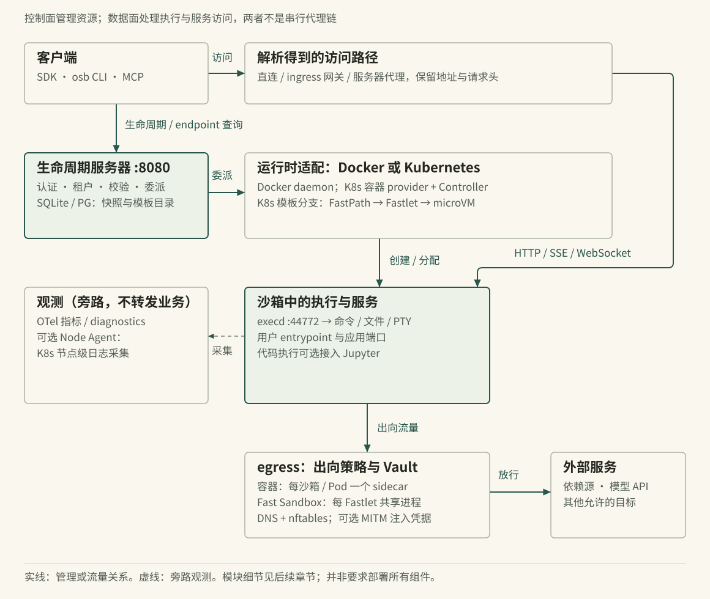
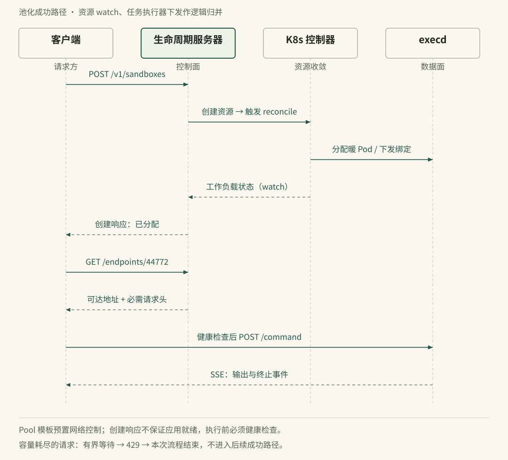
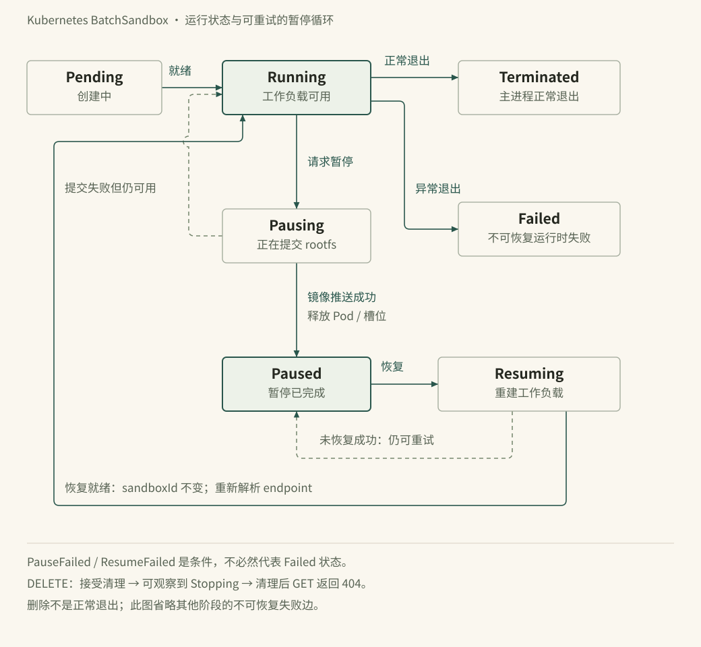

# 图表源文件与预览

三张发布图均为直接可编辑的 SVG；时序图与状态图另保留 Mermaid 语义源。自动渲染 Mermaid 不会复现发布 SVG 的手工布局，请勿覆盖发布稿。

| 图 | 发布源 | 语义源 | 位置 |
|---|---|---|---|
| 整体架构 | architecture.svg | — | 第 02 篇 |
| BatchSandbox 池化成功路径 | request-flow.svg | request-flow.mmd | 第 02 篇 |
| BatchSandbox 运行与暂停循环 | lifecycle.svg | lifecycle.mmd | 第 13 篇 |

## 整体架构

## 创建与执行

## 生命周期

PNG 截图在 `preview/`，来自最终 SVG 的浏览器渲染。

## 维护与检查

- 编辑发布稿：直接改 SVG 的节点、文字与正交路径。
- Mermaid 是逻辑交流用的辅助源；可用 `mmdc -i request-flow.mmd -o /tmp/request-flow.svg -c mermaid.json -p puppeteer.json` 预览。`puppeteer.json` 的 Chromium 路径是本机设置。
- 正文图指令由 `wiki/build.mjs` 处理：站点引用 SVG，离线合订本用 data URI 封装原始字节，EPUB 打包独立资源。
- `checks/geometry.js` 在 `#stage` 内嵌 SVG 上检查越界、压字和节点相交；需浏览器执行。
- 每次改图同时更新 `preview/`、运行构建与 `wiki/verify.py`，然后读取截图复核。几何无告警不能证明语义正确。

本轮技术问题、修复和测试结果见根目录 `VALIDATION.md`。
